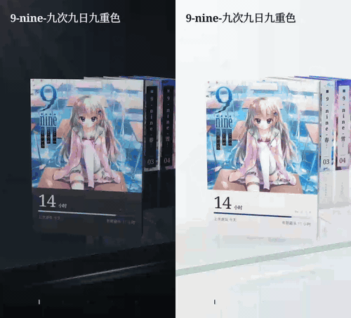

# KireiShelf

一个 Jetpack Compose 组件：把一组封面排成斜着看的文库本书架。左右滑动翻书，选中的书会从书架里抽出来、转过来露出封面，点它就会回调 `onOpen`。



## 技术栈

Kotlin · Jetpack Compose · Android Canvas · AGSL

- 最低 Android 8.0（API 26）
- Android 13+ 用 AGSL 逐像素打光；低版本用简化的平面光照
- 只依赖 Compose Foundation，没有第三方库

## 使用

把 `kireishelf/` 文件夹复制到你的项目里：

```kotlin
KireiShelf(
    books = listOf(
        ShelfBook(id = 1, title = "夏日的回忆", cover = bitmap, playTime = 12 * 3_600_000L),
    ),
    onOpen = { book -> },
)
```

`ShelfBook`

| 字段 | 说明 |
|---|---|
| `id` | 唯一 id |
| `title` | 书名，显示在顶部和书脊上 |
| `cover` | 封面 `Bitmap`，竖版；`null` 显示纯色封面 |
| `playTime` | 时长（毫秒），腰封上的大数字 |
| `lastPlayedAt` | 上次打开的时间戳（毫秒），`0` 表示从未 |

`KireiShelf` 还有 `dark`（默认跟随系统）、`emptyText`（没有书时的提示）和 `modifier`。

## 文件

| 文件 | 内容 |
|---|---|
| `KireiShelf.kt` | 对外接口 `ShelfBook`、`KireiShelf()`，滑动手感和拖动条 |
| `ShelfLabels.kt` | 书上印的一切：文字（如书脊上的 `KIREI` 标记）、腰封排版、书脊标签和颜色 |
| `ShelfTextures.kt` | 把封面画成护封、书脊、腰封的贴图，封面取色，缓存 |
| `ShelfRender.kt` | 透视相机、每帧绘制、玻璃台面、AGSL 材质、影棚背景 |

想改书上的字或标签样式，只需要改 `ShelfLabels.kt`。

## 运行 demo

demo 是一个独立的 Android 项目，用 Android Studio 打开 `demo/` 文件夹，或者：

```bash
cd demo && ./gradlew installDebug
```

把封面图放进 `demo/src/main/assets/covers/`，文件名就是书名，开头的序号用来排序，例如 `1_夏日的回忆.jpg`。这个文件夹不会提交；空着时 demo 会生成几本示例书。

## 许可

MIT
